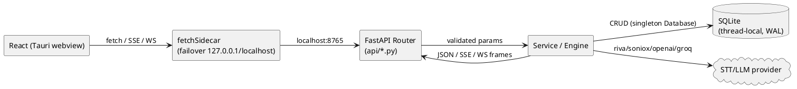
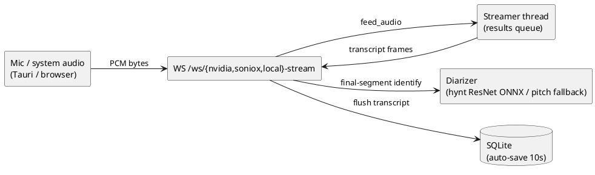

<!-- Generated by be-codemap on 2026-10-09 11:32 -->
<!-- Project: voicescribe (v1.3.2) -->
<!-- Re-run: /be-codemap --partial architecture -->

# Kiến trúc

Desktop 3-tier chạy local: **React webview (Tauri) ↔ FastAPI sidecar (localhost:8765) ↔ SQLite + STT/LLM providers**.
Rust layer làm cầu nối cho tác vụ web JS không làm được: capture audio hệ thống,
stream file upload tới sidecar, lưu file.

## Cấu trúc Layer

| Layer        | Pattern                          | File ví dụ                          |
| ------------ | -------------------------------- | ----------------------------------- |
| Tauri cmds   | `#[tauri::command]`              | `src-tauri/src/lib.rs`, `upload.rs` |
| Frontend API | `fetchSidecar(path)` failover 2 base URLs | `src/lib/sidecar.ts`, `api.ts` |
| API/Routes   | `@router.get/post/patch/delete`, `@app.websocket` | `src-python/api/*.py`, `main.py` |
| Services     | pipeline + `JobRegistry`, pure helpers | `src-python/services/*.py`    |
| Engines      | STT streaming classes, diarizer  | `src-python/stt.py`, `diarize.py`, `local_stt.py` |
| Persistence  | singleton `Database`, raw SQL    | `src-python/db.py`                  |
| Config       | SQLite `settings` + env fallback  | `db.get_setting(key) or os.getenv(...)` |

Routers không dùng `prefix=` — mỗi `@router.<method>("/full-path")` khai path đầy đủ,
`main.py` chỉ `include_router` 7 routers.

## Luồng dữ liệu

### HTTP Request

### Luồng Event (realtime STT)

### Upload pipeline (file lớn)

`pick_audio_file` (Rust) → stream Rust→sidecar `POST /meetings/upload-audio`
(2GB cap; các route khác 50MB) → `run_pipeline` chunk file (VAD splitter) →
STT từng chunk (nvidia chunked / soniox 2-step / local) → batch diarizer →
rebuild transcript → optional summarize. Tiến độ qua `GET /jobs/{id}/events` (SSE),
quản lý bởi `services/job_registry.py`, resume sau crash (`resurrect_stuck_meetings_on_boot`).

## Nguồn cấu hình

| Nguồn            | Vị trí                          | Mục đích                                      |
| ---------------- | ------------------------------- | --------------------------------------------- |
| Env vars         | `VOICESCRIBE_DATA`, `SIDECAR_PORT`, `NVIDIA_API_KEY`, `SONIOX_API_KEY`, `LLM_API_KEY`, `LLM_MODEL`, `LLM_BASE_URL`, `DIARIZE_*` | Data dir, port, keys, ngưỡng diarizer |
| SQLite settings  | bảng `settings` (`db.get_setting`) | Keys, ngôn ngữ, provider, model — override env |
| Constants        | `diarize.py` top-level, `main.py` middleware | `DIARIZE_MIN_BYTES`, upload caps (50MB/2GB) |
| Frontend         | Tauri webview + localStorage/zustand | UI state, không chứa secrets                |

Thứ tự ưu tiên key/API: `db.get_setting(key) or os.environ.get(...)`.

## Dependency dùng chung

| Tiện ích          | Vị trí                          | Được dùng bởi                                          |
| ----------------- | ------------------------------- | ------------------------------------------------------ |
| `Database` singleton | `src-python/db.py`           | `main.py`, cả 7 routers, `upload_pipeline`             |
| `get_logger`      | `src-python/logger.py`          | ~20 modules (tất cả trừ spec/tests)                    |
| `t(key, lang)`    | `src-python/i18n.py`            | `main.py`, `diagnose.py` (thông điệp vi/en)            |
| `SpeakerDiarizer` | `src-python/diarize.py`         | `main.py` (inject vào transcription/diagnose routers), `batch_diarizer` |
| `find_ffmpeg`     | `src-python/services/audio.py`  | `stt.py`, `vad_splitter`, `local_stt`, `meetings.py`   |
| `fetchSidecar`    | `src/lib/sidecar.ts`            | `api.ts`, `attachments.ts`, `sse.ts`, `upload-audio.ts` |
| `appStore`        | `src/stores/appStore.ts`        | toàn bộ components                                     |

## Graph Architecture Insights (từ `code-review-graph`, build 2026-10-09)

- Graph: **996 nodes, 10934 edges, 118 files**, ngôn ngữ: python, typescript/tsx, rust, bash.
- Cụm coupling mạnh nhất quan sát từ scan: `upload_pipeline` ↔ `stt` ↔ `db` ↔ `job_registry`
  (pipeline import trực tiếp cả 4) — thay đổi contract STT lan tới pipeline + API upload.
- `db.Database` là hub hình sao: mọi router + pipeline phụ thuộc singleton này;
  đổi schema phải đi qua `_migrate_v2` idempotent (đã có tiền lệ fix fresh-install).
- Frontend coupling: mọi data access đi qua `src/lib/sidecar.ts` (`fetchSidecar`) —
  đổi base URL/port chỉ chạm 1 file.
- Không phát hiện circular import giữa các module Python (imports đều hướng về
  `core`: `db`, `logger`, `stt`, `diarize`; `api` → `services` → `core`, một chiều).
