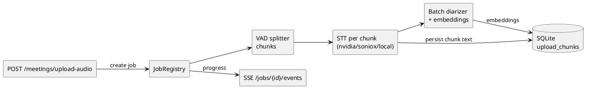

<!-- Generated by be-codemap on 2026-10-09 11:32 -->
<!-- Project: voicescribe (v1.3.2) -->
<!-- Re-run: /be-codemap --partial async-flows -->

# Luồng bất đồng bộ

Không dùng Kafka/Celery/APScheduler. Async gồm: **3 WebSocket streaming servers,
2 SSE streams, background threads, asyncio pipeline**.

## Kafka Topics

Không phát hiện Kafka integration trong project này.
Nếu project sử dụng Kafka với wrapper custom, chạy lại `/be-codemap` sau khi kiểm tra patterns.

## WebSocket Streams (realtime STT)

| Path | Engine | Handler | File |
|------|--------|---------|------|
| `/ws/nvidia-stream` | `NvidiaStreamingSTT` (Riva gRPC) | `nvidia_stream_ws` | `src-python/main.py:288` |
| `/ws/local-stream` | `LocalStreamingSTT` (nemotron MLX / sherpa-onnx) | `local_stream_ws` | `src-python/main.py:571` |
| `/ws/soniox-stream` | `SonioxStreamingSTT` (wss realtime) | `soniox_stream_ws` | `src-python/main.py:800` |

Chi tiết chung:

- **Kết quả**: thread `_read_results` pump SDK generator → `asyncio.Queue` → task `_send_results`.
- **Diarization**: buffer PCM tới `DIARIZE_MIN_BYTES`, `identify_speaker_from_samples` qua executor.
- **Dịch**: per-chunk task (`translate_instant`) với `chunk_id` (nvidia/local); Soniox throttle 1.5s/30 chars.
- **Ổn định**: Riva reconnect backoff có giới hạn retry; Soniox forward `{error, terminal}` khi 402/auth fail
  (fix v1.2.15: trước đây error text leak thành segment "System"), heartbeat `{type: info}` khi reconnect.
- **`/ws/local-stream` guard**: chỉ chạy khi Tier A nemotron + MLX khả dụng, ngược lại trả lỗi tiếng Việt gợi ý dùng Upload file.

## SSE Streams

| Path | Handler | File |
|------|---------|------|
| `/logs` | `logs_stream` (ring buffer 500 dòng + subscriber queues) | `src-python/main.py:262` |
| `/jobs/{job_id}/events` | job progress events | `src-python/api/upload.py:158` |

## Background work

| Tác vụ | Cơ chế | File |
|--------|--------|------|
| Diarizer ResNet load + warm-up (zeros 16k samples) | `threading.Thread(daemon)` trong `lifespan` | `main.py:200-226` |
| Riva warm-up (nếu có key) | `threading.Thread(daemon)` | `main.py:213` |
| Upload pipeline (chunk → STT → diarize → rebuild → summarize) | `asyncio.to_thread` + executor, `JobRegistry` | `services/upload_pipeline.py`, `services/job_registry.py` |
| Soniox 2-step: upload file → poll transcription → delete | async poll với backoff, chunk-level retry + DB persist | `stt.py:350-746`, `upload_pipeline.py:645-1231` |
| Boot resurrect meetings kẹt `uploading` | sync trong `lifespan` sau `db.init()` | `services/upload_pipeline.py` via `main.py:177` |

## Chuỗi Event (upload pipeline)

## Tác vụ định kỳ (Scheduled Tasks)

Không phát hiện scheduler (cron/APScheduler/Celery) trong project này —
mọi background work đều do request/WS/lifespan kích hoạt.
