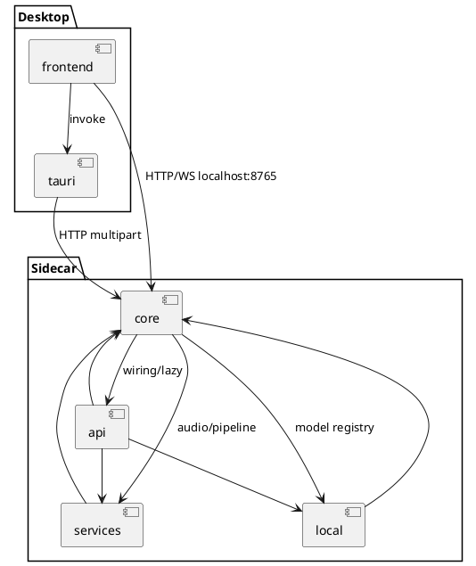

<!-- Generated by be-codemap on 2026-10-09 11:32 -->
<!-- Project: voicescribe (v1.3.2) -->
<!-- Re-run: /be-codemap --partial dependency-graph -->

# Đồ thị Dependency

Imports Python một chiều, hội tụ về `core`: `api` → `services` → `core`.
Không phát hiện circular import giữa các module.

## Dependency giữa các Module

| Module | Import từ | Được import bởi |
|--------|-----------|-----------------|
| api | core (`db`, `logger`, `stt`), services (`job_registry`, `upload_pipeline`, `audio`, `minutes`), local (`device_detect`, `model_registry`, `model_download`) | core (`main.py` include routers; `summarize.py` dùng `api.settings._PROVIDER_URLS`) |
| core | api (`main.py` wiring; `summarize` → `api.settings`), services (`services.audio`, `services.upload_pipeline`), local (`local.*`) | api, services, local |
| services | core (`db`, `stt`, `local_stt`, `diarize`, `summarize`) | api (`upload`, `meetings`, `diagnose` gián tiếp), core (`main.py`) |
| local | core (`local_stt`) | core (`local_stt.py`, `api/settings.py`), tests |
| frontend (`src/`) | sidecar HTTP/WS (`src/lib/sidecar.ts` là hub) + Tauri `invoke` | — (không bị import ngược) |
| tauri (`src-tauri/`) | sidecar HTTP (reqwest multipart stream) | frontend qua `invoke` |

## Tiện ích dùng chung

| Tiện ích | Vị trí | Số module import |
|----------|--------|------------------|
| `Database` | `src-python/db.py` | 3 (api ×7 files, services/upload_pipeline, core/main) |
| `get_logger` | `src-python/logger.py` | 4 (mọi module Python) |
| `find_ffmpeg` | `src-python/services/audio.py` | 2 (core: `stt`, `local_stt`, `meetings` via api; services: `vad_splitter`) |
| `SpeakerDiarizer` | `src-python/diarize.py` | 2 (core/main inject; services/batch_diarizer) |
| `fetchSidecar`/`sidecarUrl` | `src/lib/sidecar.ts` | 1 hub cho 4 consumers (`api`, `attachments`, `sse`, `upload-audio`) |
| `JobRegistry` | `src-python/services/job_registry.py` | 2 (api/upload, services/upload_pipeline) |

## Gọi Service bên ngoài

| Đích | Client | Method | File |
|------|--------|--------|------|
| Nvidia Riva gRPC (`grpc.nvcf.nvidia.com:443`) | `riva.client` ASRService | streaming + batch recognize | `src-python/stt.py`, `translate.py:68` |
| Soniox API (`/v1/files`, realtime `wss`) | `SonioxClient` | upload → transcribe → delete; realtime STT | `src-python/stt.py:396-746, 952-1338` |
| LLM OpenAI-compatible (`/v1`) | `openai.OpenAI` / `httpx.AsyncClient` | summarize, translate, list models | `src-python/summarize.py:267`, `api/settings.py:129`, `api/diagnose.py:310` |
| Groq / Gemini endpoints | base URL trong `_PROVIDER_URLS` | tương tự OpenAI-compatible | `src-python/api/settings.py:23-28` |

## Circular Dependencies

Không phát hiện. Lưu ý duy nhất dạng lazy-import có chủ đích (tránh import cost lúc startup,
không phải cycle): `from stt import ...` / `from services.upload_pipeline import ...` đặt trong
function body (`main.py:177`, `settings.py:98`, `diagnose.py:214+`).

## Ma trận Dependency

## Cộng đồng code (từ graph, `code-review-graph`: 996 nodes / 10934 edges)

Cụm liên kết dày quan sát từ imports: {`upload_pipeline`, `stt`, `db`, `job_registry`,
`vad_splitter`, `batch_diarizer`, `upload_storage`} — pipeline upload là cụm coupling
cao nhất repo; đổi contract chunk (DB `upload_chunks` hoặc segment format) chạm cả cụm.
Cụm thứ hai: {`main.py` WS handlers, `diarize`, `local_stt`, `translate`} — realtime path.
Cụm rời: frontend `recording/*` hooks ↔ `src/lib/*` (chỉ giao tiếp sidecar qua HTTP/WS,
không import Python).
